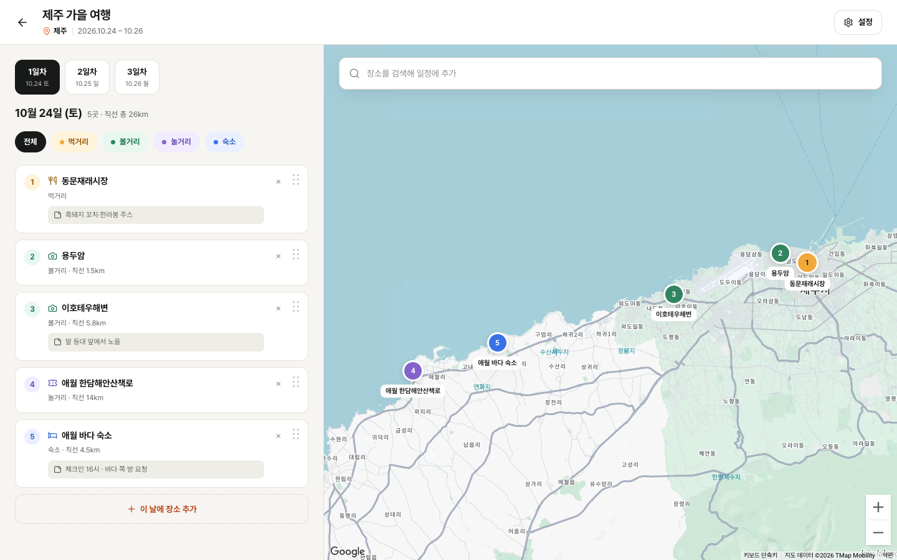
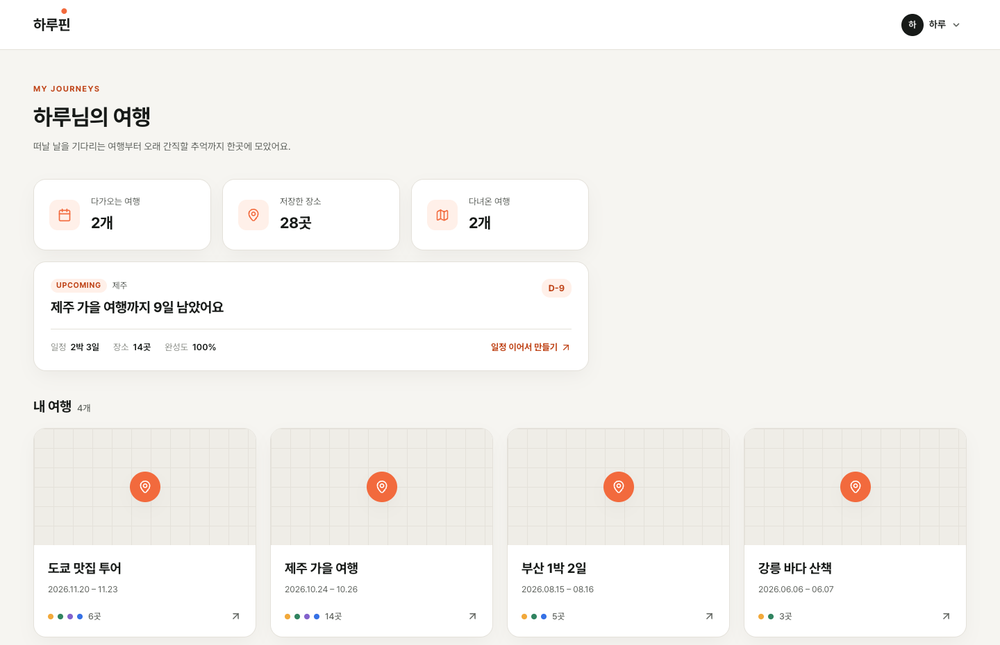
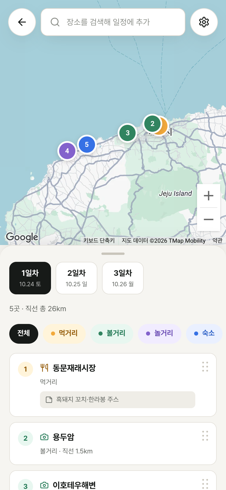
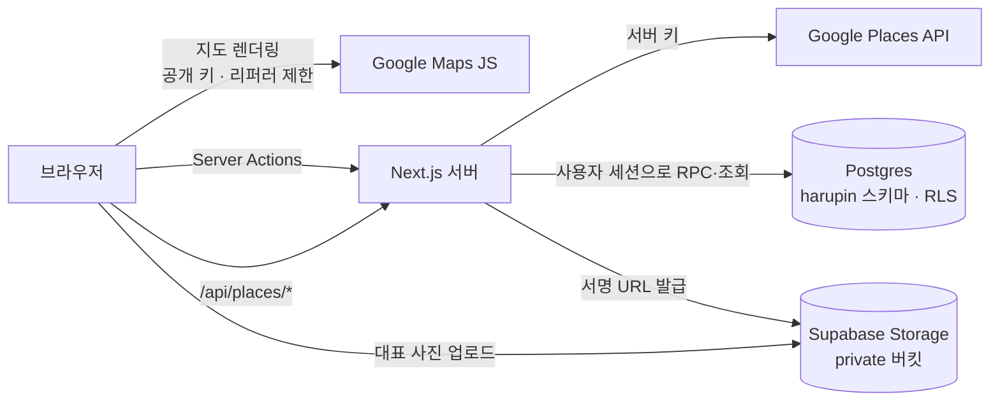

# 하루핀 (Harupin)

> 지도에 핀을 찍으며 날짜별로 동선을 짜는 여행 계획 웹앱

장소를 검색해 핀을 찍고, 일차별로 순서를 정리하는 흐름 하나에 집중했습니다.
국내와 해외 여행을 모두 지원하며, 데스크톱은 목록과 지도를 나란히 놓은 스플릿 뷰로, 모바일은 지도 위 바텀시트로 씁니다.



<table>
  <tr>
    <th>홈</th>
    <th>모바일 일정 편집</th>
  </tr>
  <tr>
    <td valign="top"></td>
    <td valign="top" width="30%"></td>
  </tr>
</table>

<sub>스크린샷은 로컬 Supabase에 넣은 데모 데이터로 찍었습니다.</sub>

## 주요 기능

- **여행 만들기**: 제목과 기간을 입력하면 일차(Day)가 자동으로 생깁니다. 제목·지역·기간 수정, 대표 사진, 여행 삭제를 지원합니다.
- **장소 검색과 추가**: Google Places 자동완성으로 장소를 찾아 카테고리(먹거리·볼거리·놀거리·숙소)를 골라 일차에 넣습니다.
- **일정 편집**
  - 핸들을 끌어 순서를 바꿉니다(키보드도 지원).
  - 다른 일차로 옮기거나 삭제할 수 있고, 삭제는 5초 안에 되돌릴 수 있습니다.
  - 메모를 남길 수 있고, 메모 속 링크는 클릭됩니다.
- **지도**: 카테고리 색 순번 핀(1→2→3)을 보여주고, 일차를 바꾸면 그 날의 핀이 모두 보이게 화면을 맞춥니다. 카테고리 필터를 지원합니다.
- **이동 거리**: 장소 사이의 직선 거리와 일차별 합계를 보여줍니다.
- **홈**: 여행 통계, 다가오는 여행(D-day·완성도), 대표 사진이 들어간 여행 카드를 보여줍니다.
- **모바일**: 바텀시트를 끌어 3단계(22·50·88%)로 높이를 맞추고, 카드를 밀어 삭제합니다.
- **링크 미리보기**: OG 이미지와 앱 아이콘을 갖췄습니다.

## 기술 스택

| 영역           | 사용 기술                                                                      |
| -------------- | ------------------------------------------------------------------------------ |
| 프레임워크     | Next.js 16 (App Router, Server Actions, `proxy.ts`), React 19 + React Compiler |
| 언어·스타일    | TypeScript, Tailwind CSS v4 (`@theme` 디자인 토큰)                             |
| DB·인증·파일   | Supabase (Postgres + RLS, Auth/Google OAuth, Storage)                          |
| 지도·장소      | Google Maps JavaScript API (`@vis.gl/react-google-maps`), Places API (New)     |
| 드래그 앤 드롭 | dnd-kit                                                                        |
| 검증           | Zod, T3 Env                                                                    |
| 배포           | Vercel                                                                         |

## 아키텍처



- 데이터는 서버 컴포넌트에서 조회하고, 쓰기는 Server Action이 DB 함수(RPC)를 부릅니다.
- 모든 쿼리는 사용자 세션으로 실행됩니다. 권한은 앱 코드가 아니라 RLS가 판단합니다.
- 과금되는 Places 호출은 서버 프록시로만 나갑니다.

## 기술적으로 고민한 것

### 1. 과금 API를 공개 프록시로 열지 않기

`/api/places/*`는 내 서버 키로 Google에 대신 호출해 주는 엔드포인트입니다. 아무 보호 없이 두면 누구나 내 쿼터를 쓸 수 있습니다.
쿼터 상한만 걸면 과금 사고가 장애 사고로 바뀔 뿐이라, 여러 겹으로 막았습니다.

- **키 분리**: 번들에 노출되는 브라우저 키는 리퍼러와 Maps JavaScript API로만 제한하고, 과금 호출은 서버 전용 키로만 합니다.
  - 브라우저 키도 프로덕션용과 로컬용을 따로 둡니다.
- **로그인 필수**: 세션이 없는 요청은 401을 받습니다. 이 방어선 때문에 인증을 로드맵 7번째에서 2번째로 당겼습니다.
- **레이트리밋**: Postgres 함수(`check_rate_limit`, 고정 윈도우 카운터)로 제한합니다. 자동완성은 60초에 40회, 상세 조회는 20회입니다.
  - 별도 Redis 없이 이미 있는 DB로 해결했습니다.
- **세션 토큰과 디바운스**: 자동완성 요청과 마지막 상세 조회를 하나의 세션 토큰으로 묶어 세션 단위로 과금되게 했습니다. 입력은 300ms 디바운스를 겁니다.

### 2. RLS 한 줄로 끝나는 권한 모델

장소의 주인을 확인하려면 `places → days → trips`를 두 번 조인해야 하고, RLS 정책이 이 조인을 행마다 실행합니다.
그래서 `days`와 `places`에도 `user_id`를 두어(비정규화) 정책을 `user_id = auth.uid()` 한 줄로 줄였습니다.

- 중복 저장된 값이 어긋나지 않도록 **복합 FK**를 겁니다: `places(day_id, trip_id, user_id) → days(id, trip_id, user_id) → trips(id, user_id)`. 남의 Day에 내 장소를 붙이는 것을 DB가 거부합니다.
- 익명 사용자용 정책은 만들지 않았습니다. 처음 설계한 "`is_public`이면 공개" 정책은 익명 사용자가 공유용 `share_id`까지 통째로 읽을 수 있다는 것을 실측으로 확인하고 뺐습니다. 공유 뷰는 `share_id`를 인자로 받는 함수로 열 계획입니다.
- 테이블 권한(grant)도 정책과 같은 범위로 좁게 줍니다. "RLS가 어차피 막는다"며 넓게 주면, 정책 하나만 실수해도 바로 데이터가 노출됩니다.

### 3. 순서가 걸린 쓰기는 DB 함수로, 잠금 순서는 하나로

방문 순서(`visit_order`)를 앱에서 "최댓값 + 1"로 계산하면 동시 요청에서 순번이 겹칩니다.
그래서 추가, 순서 변경, 일차 이동, 여행 수정을 모두 `security invoker` RPC로 만들어 RLS가 그대로 적용되게 했습니다.

- **잠금 순서 통일**: 모든 함수가 여행 → Day(id 순서) → 장소 순서로 잠급니다. 두 Day를 잡는 `move_place`도 id 순서를 따릅니다. 로컬에서 함수들을 동시에 실행해 교착이 생기지 않는 것을 확인했습니다.
- **순번 맞바꾸기**: `(day_id, visit_order)` unique를 `deferrable initially deferred`로 두어, 순번을 서로 바꾸는 갱신이 한 문장으로 통과합니다.
- **날짜 재배치**: `days(trip_id, date)` unique는 deferrable이 아니어서, 날짜를 하루씩 밀면 아직 옮기지 않은 옆 행과 부딪혔습니다(실측). 그래서 옛 범위와 새 범위보다 모두 뒤인 날짜로 먼저 비켜 둔 뒤 제자리로 옮깁니다.
- **기간 축소**: 잘려 나가는 뒤쪽 일차가 비어 있을 때만 허용해서, 날짜를 잘못 고쳐도 장소가 사라지지 않습니다.

### 4. 다른 앱과 같은 Supabase 프로젝트에 얹기

무료 플랜의 프로젝트 자리가 모두 차서, 기존 프로젝트에 전용 스키마 `harupin`을 만들어 데이터를 분리했습니다.
그런데 마이그레이션 이력 테이블은 프로젝트당 하나이고 기존 앱이 쓰고 있어서, `supabase db push`가 거부됩니다. CLI가 제안하는 `migration repair`와 `db pull`은 기존 앱의 배포를 깨뜨립니다.

이 문제를 피하려고 작은 배포 스크립트(`scripts/db-deploy.mjs`)를 만들었습니다.

- 하루핀 전용 이력 테이블(`harupin.schema_migrations`)에 파일 이름과 sha256 체크섬을 기록합니다.
- 파일마다 트랜잭션으로 적용합니다. 실패하면 그 파일만 롤백하고 멈춥니다.
- 이미 적용한 파일이 바뀌면 경고합니다.
- DB 접속 시 TLS 검증을 끄지 않고 Supabase CA 인증서로 고정합니다.

### 5. 대표 사진은 private 버킷과 서명 URL로

개인 여행 사진이고, public 버킷이면 공개 URL에 사용자 ID와 여행 ID가 드러나서 private 버킷으로 정했습니다.

- 브라우저에서 긴 변 1200px의 WebP로 줄여 Storage에 바로 올립니다. 그래서 Server Action 본문 크기 제한에 걸리지 않습니다.
- 올리기 정책은 경로 형식, 본인 폴더, **본인 여행 폴더**인지 모두 확인합니다. `trips.cover_path`도 CHECK 제약으로 본인 경로만 허용합니다.
- 화면에서는 서버가 서명 URL을 한 번에 발급합니다. 사진을 바꾸면 이전 파일을 지우고, 여행을 지우면 폴더를 비웁니다.

### 6. 국내에서는 경로선 대신 순번 핀과 직선 거리

Google은 국내 자동차 경로를 제공하지 않아서, 경로선을 그리려면 국내와 해외에 서로 다른 API를 써야 합니다.
복잡도에 비해 효용이 낮다고 보고 **순번 핀(1→2→3)과 좌표로 계산한 직선 거리**로 대신했습니다.
API를 호출하지 않으니 비용이 들지 않고, 실제 이동 거리와 헷갈리지 않도록 화면에 항상 "직선"이라고 적습니다.

### 7. 끊기지 않는 편집 경험

- **낙관적 업데이트**: 순서를 바꾸면 `useOptimistic`으로 화면에 먼저 반영하고, 저장에 실패하면 서버 값으로 돌아갑니다.
- **되돌릴 수 있는 삭제**: 삭제는 5초 뒤에 서버로 보냅니다. 지웠다가 다시 넣는 방식은 id와 순번이 바뀌어 원래대로 돌아가지 않기 때문입니다.
- **필터를 켜도 순번 유지**: 필터를 켜도 세 번째 방문지는 여전히 3번입니다. 순서를 저장할 때 숨긴 장소는 제자리를 지킵니다.
- **접근성**: 키보드로 순서를 바꿀 수 있고, 드래그 상황을 한국어로 안내합니다. 일차 이동 결과는 `role="status"`로 알리고, 본문 텍스트 색은 WCAG AA 대비를 맞췄습니다.

### 8. 지도 핀과 OG 이미지에서 만난 제약

- **지도 핀**: `AdvancedMarker`는 `mapId`가 필요한데, `mapId`를 쓰면 코드로 지정한 저채도 지도 스타일이 무시됩니다. 그래서 `OverlayView` 기반의 `HtmlMarker`를 직접 만들었습니다.
- **OG 이미지**: `next/og`가 woff2와 가변 폰트를 읽지 못해서 Pretendard를 정적 TTF로 변환했습니다(`scripts/build-og-fonts.py`). OFL 라이선스에 따라 수정본은 이름을 바꾸고, 저작권·라이선스 고지는 폰트 안에 남겼습니다.

## 프로젝트 구조

```
src/
├── app/                 라우트 (홈, 로그인, 일정 편집, Places 프록시, OG·아이콘)
├── components/
│   ├── itinerary/       일정 편집 화면 (TripEditor, 목록·카드·다이얼로그, hooks/)
│   ├── map/             지도, 순번 핀, 카메라 제어
│   ├── places/          장소 검색 (자동완성)
│   ├── trips/           홈 화면 카드·통계
│   ├── brand/ layout/   워드마크, 앱 헤더·계정 메뉴
│   └── ui/              Dialog, Toast 등 도메인 없는 공용 조각
├── lib/                 React와 무관한 코드
│   ├── actions/         Server Actions
│   ├── queries/         서버 조회
│   ├── supabase/        Supabase 클라이언트 (브라우저·서버)
│   ├── env.ts           환경변수 검증
│   └── trips/ places/ map/ ui/   도메인별 타입·상수·계산
└── proxy.ts             라우트 보호
supabase/migrations/     스키마, RLS, DB 함수, Storage 정책
scripts/                 원격 마이그레이션, OG 폰트·파비콘 생성
```

- 타입은 도메인 폴더에 두고, 훅은 그 훅을 쓰는 기능 폴더 안에 둡니다.
- 서로 값이 맞아야 하는 상수와 DB CHECK 제약(길이 상한, 기간 상한 366일 등)은 주석으로 서로를 가리키게 했습니다.

## 로컬에서 실행하기

### 준비물

- Node.js 20.9 이상, pnpm 11 (`packageManager`로 고정, Corepack 권장)
- Docker (Supabase 로컬 스택용)
- Google Cloud: Maps JavaScript API용 브라우저 키, Places API용 서버 키, OAuth 클라이언트

### 1. 의존성 설치

```bash
pnpm install
```

### 2. Google 로그인 설정

로그인은 Google OAuth만 지원하고, `/login`을 뺀 모든 화면이 로그인을 요구합니다. 그래서 로컬에서도 OAuth 설정이 필요합니다.

- 루트 `.env`에 OAuth 클라이언트 값(`SUPABASE_AUTH_EXTERNAL_GOOGLE_CLIENT_ID`, `SUPABASE_AUTH_EXTERNAL_GOOGLE_SECRET`)을 넣습니다. `.env.local`이 아니라 루트 `.env`입니다.
- OAuth 클라이언트의 승인된 리디렉션 URI는 `http://127.0.0.1:54321/auth/v1/callback`입니다.
- 이 값은 스택을 띄울 때 들어갑니다. 바꾼 뒤에는 `pnpm supabase stop` 후 다시 시작합니다.

### 3. Supabase 로컬 스택 실행

```bash
pnpm supabase start
```

처음 실행하면 `supabase/migrations`가 적용됩니다. 다음 단계에 넣을 값은 아래 명령의 `API_URL`과 `ANON_KEY`입니다.

```bash
pnpm supabase status -o env
```

### 4. 앱 환경변수

```bash
cp .env.example .env.local
```

| 변수                            | 넣을 값                                    |
| ------------------------------- | ------------------------------------------ |
| `NEXT_PUBLIC_MAPS_KEY`          | 브라우저 키 (`localhost:3000` 리퍼러 제한) |
| `MAPS_SERVER_KEY`               | 서버 키 (Places API만 허용)                |
| `NEXT_PUBLIC_SUPABASE_URL`      | 3단계의 `API_URL`                          |
| `NEXT_PUBLIC_SUPABASE_ANON_KEY` | 3단계의 `ANON_KEY`                         |

### 5. 개발 서버 실행

```bash
pnpm dev
```

http://localhost:3000 에서 Google 계정으로 로그인합니다.

### 명령어

| 명령             | 하는 일                                   |
| ---------------- | ----------------------------------------- |
| `pnpm check`     | lint, 포맷 검사, 빌드                     |
| `pnpm typecheck` | 타입 검사                                 |
| `pnpm db:status` | 원격 DB에 적용되지 않은 마이그레이션 확인 |
| `pnpm db:deploy` | 원격 DB에 마이그레이션 적용               |

`db:*` 명령에는 두 가지가 필요합니다. 둘 다 저장소에 넣지 않습니다.

- 루트 `.env`의 `SUPABASE_DB_URL` (대시보드 → Settings → Database → Connection string, Session 모드)
- `supabase/prod-ca-2021.crt` (대시보드 → Settings → Database → SSL Configuration)

## 앞으로 할 것

- **공유 링크**: 읽기 전용 공유 뷰와 여행별 OG 이미지
- **Place Details 캐시**: 주소와 영업시간 표시. Places 약관의 캐시 허용 범위를 확인한 뒤 적용합니다.
- **핀 클러스터링**: 장소가 많을 때 핀 묶기
- **해외 구간 실제 이동 시간**: Google Routes API

## 크레딧

- 글꼴: [Pretendard](https://github.com/orioncactus/pretendard) (SIL Open Font License 1.1). OG 이미지용 수정본은 `HarupinOG`라는 이름으로 포함했습니다.
